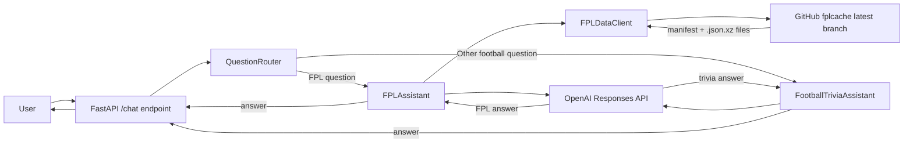

# FPL Stato

FPL Stato is an OpenAI-powered football assistant. It answers Fantasy Premier
League questions using current FPL data from the `mdoh80/fplcache` GitHub
repository, and answers general football trivia using the OpenAI model's
knowledge.

## How it works



The routing, data, and OpenAI layers are separate:

- `QuestionRouter` uses deterministic rules to route explicit FPL questions to
  `FPLAssistant`; other football questions go to `FootballTriviaAssistant`.
- `FPLDataClient` downloads, decompresses, and validates the FPL data.
- `FPLAssistant` gives the current FPL data to OpenAI with the user’s question.
- `FootballTriviaAssistant` answers general football history, rules,
  tournaments, and club-fact questions from the model’s knowledge. It does not
  download live football data or use web search, so current or obscure facts
  may be uncertain.
- The FastAPI application exposes the assistant through HTTP.

### Question routing

Questions that clearly concern the user’s FPL team, transfers, captaincy
decisions, gameweeks, chips, player prices, or FPL statistics use
`FPLAssistant` and the current FPL snapshot. General football questions—such
as football history, rules, tournaments, club facts, or ordinary club fixture
questions—use `FootballTriviaAssistant` and do not load FPL data.

Routing is local and deterministic; it does not make an additional model call
just to classify a question. Ambiguous questions follow the routing rules and
may need to be phrased with explicit FPL context for data-backed analysis.

## Requirements

You need:

- Python 3.12 or newer
- An OpenAI API key
- Internet access to GitHub and the OpenAI API

## First-time setup

From the repository directory:

```bash
python3.12 -m venv .venv
source .venv/bin/activate
python -m pip install -e ".[web,test]"
```

Set your OpenAI API key in the current terminal:

```bash
export OPENAI_API_KEY="your-api-key-here"
```

Do not commit your API key or put it in a source file. The OpenAI Python SDK
reads `OPENAI_API_KEY` automatically.

## Run the data check

This downloads the current cache and prints a small summary:

```bash
python -m fpl_stato
```

Example output:

```json
{
  "gameweek": 5,
  "players": 667,
  "teams": 20,
  "fixtures": 380,
  "live_players": 667
}
```

The numbers change as the FPL season progresses.

To use another compatible cache location:

```bash
python -m fpl_stato --base-url "https://example.com/fplcache/latest/"
```

## Run the chat API

Start the development server:

```bash
uvicorn fpl_stato.api:app --host 127.0.0.1 --port 8000
```

Keep that terminal running. In a second terminal, activate the environment and
send a request:

```bash
source .venv/bin/activate
curl http://127.0.0.1:8000/health
```

You should see:

```json
{"status":"ok"}
```

Ask an FPL question:

```bash
curl -X POST http://127.0.0.1:8000/chat \
  -H "Content-Type: application/json" \
  -d '{"question":"Who should I captain this gameweek?"}'
```

Ask a general football trivia question through the same endpoint:

```bash
curl -X POST http://127.0.0.1:8000/chat \
  -H "Content-Type: application/json" \
  -d '{"question":"Who won the 1966 World Cup?"}'
```

The response has this shape:

```json
{"answer":"..."}
```

For interactive API documentation, open
`http://127.0.0.1:8000/docs` in a browser while the server is running.

## Run the tests

With the virtual environment active:

```bash
python -m pytest -q
```

The tests use mocked downloads and mocked OpenAI responses, so they do not
spend API credits or depend on the live services.

## Useful Python usage

Fetch the FPL data directly:

```python
from fpl_stato import FPLDataClient

snapshot = FPLDataClient().fetch()
players = snapshot.bootstrap["elements"]
fixtures = snapshot.fixtures
live = snapshot.live
```

Use the assistant directly:

```python
from openai import OpenAI
from fpl_stato import FPLAssistant

assistant = FPLAssistant(openai_client=OpenAI())
answer = assistant.answer("Which players have the best upcoming fixtures?")
print(answer)
```

For general football trivia, use the trivia assistant directly:

```python
from openai import OpenAI
from fpl_stato import FootballTriviaAssistant

assistant = FootballTriviaAssistant(openai_client=OpenAI())
answer = assistant.answer("Who won the 1966 World Cup?")
print(answer)
```

## Troubleshooting

### `OPENAI_API_KEY` is missing

Set it in the same terminal that runs the API or Python command:

```bash
export OPENAI_API_KEY="your-api-key-here"
```

### `ModuleNotFoundError` for FastAPI or pytest

Activate the virtual environment and install the optional dependencies again:

```bash
source .venv/bin/activate
python -m pip install -e ".[web,test]"
```

### FPL data cannot be downloaded

Check your internet connection and try the data check again:

```bash
python -m fpl_stato
```

The application reads from the `latest` branch of `mdoh80/fplcache`. That
repository publishes `manifest.json`, `bootstrap.json.xz`, `fixtures.json.xz`,
and `live.json.xz`.

### Port 8000 is already in use

Run the server on another port:

```bash
uvicorn fpl_stato.api:app --host 127.0.0.1 --port 8001
```
